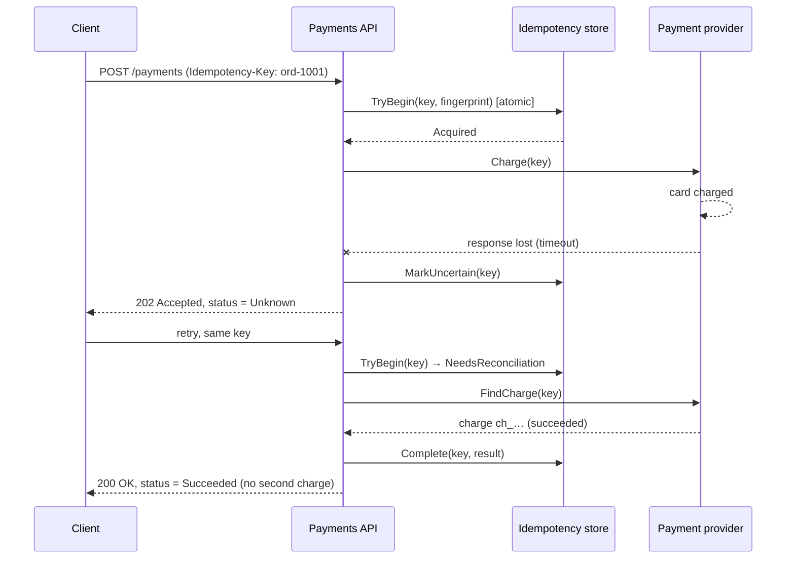

# payment-idempotency-dotnet

**Your payment API timed out. Did the payment fail, or did the response fail?**

This is a .NET 8 reference implementation that charges a customer **at most once per idempotency key**.
It holds even when the provider succeeds but the response is lost, when clients retry concurrently, or
when a worker crashes mid-request.

[](../../actions/workflows/ci.yml)


## The failure path, not just the happy path



## What it handles

| Scenario | Behaviour | Test |
|---|---|---|
| Normal request | Charges once, `201 Created` | `First_request_charges_once` |
| Client retry, same key | Returns the stored result, `200 OK`, no new charge | `Retry_with_same_key_…` |
| Same key, different body | `422 Unprocessable Entity` | `Same_key_with_a_different_body_is_rejected` |
| Provider charged, response lost | `202` with `Unknown`; the retry reconciles with the provider | `Lost_response_then_client_retry_…` |
| Timeout before the provider charged | The retry charges exactly once | `Timeout_before_charge_…` |
| 50 concurrent duplicates | Exactly one charge; the others get `409 Conflict` or a replay | `Concurrent_duplicates_…` |
| Worker crash (expired lease) | Reconcile, never charge blindly | `Expired_lease_from_a_crashed_worker_…` |
| No client retry | A background sweep resolves from the provider (read-only) | `Background_sweep_…` |

## Design decisions

1. **The key is claimed atomically.** In production this is one `INSERT … ON CONFLICT DO NOTHING`
   on a unique key ([docs/postgres-schema.sql](docs/postgres-schema.sql)), never a check followed by a write.
2. **The key goes to the provider too.** A local transaction cannot make a remote charge atomic, so
   the provider must deduplicate as well.
3. **Unknown is a first-class state.** A timeout is not a failure. See
   [ADR-0001](docs/adr-0001-provider-is-source-of-truth.md).
4. **Request fingerprinting.** A SHA-256 of the business fields detects a key reused for a different payment.
5. **Money in minor units** (`long`), never `double`.

## Run it

```bash
dotnet test
ASPNETCORE_ENVIRONMENT=Development dotnet run --project src/Payments.Api --urls http://localhost:5077

# Reproduce "charged, but response lost"
curl -X POST localhost:5077/_chaos/lose-next-response
BODY='{"customerId":"cus_42","amountMinor":2500,"currency":"USD","description":"Order 1001"}'
curl -i -H "Idempotency-Key: ord-1001" -H "Content-Type: application/json" -d "$BODY" localhost:5077/payments  # 202, Unknown
curl -i -H "Idempotency-Key: ord-1001" -H "Content-Type: application/json" -d "$BODY" localhost:5077/payments  # 200, Succeeded, same payment
```

## Production checklist

- [ ] Replace `InMemoryIdempotencyStore` with the PostgreSQL schema (or Azure SQL / Cosmos DB with a unique key).
- [ ] Use a real PSP adapter that forwards the idempotency key and supports lookup by key.
- [ ] Set a retention window longer than your clients' retry window.
- [ ] Alert on the number and age of `uncertain` payments; page someone if any is older than N minutes.
- [ ] Bound retries with exponential backoff and jitter on the client side.
- [ ] Remove the `/_chaos` endpoint (it only exists in Development).

## Structure

```
src/Payments.Api
  Domain/            PaymentRequest, PaymentResult, status
  Idempotency/       store contract, in-memory store, request fingerprint
  Providers/         provider contract + simulator with failure injection
  Reconciliation/    background sweep (read-only against the provider)
  PaymentService.cs  the decision logic
tests/Payments.Tests
docs/                PostgreSQL schema, ADR
```

---
Author: [Rubbaite T. Hassain](https://www.linkedin.com/in/rubbaite) · Software Architect, Founder of [Datazo InfoTech](https://www.datazoinfotech.com.bd) · MIT License
